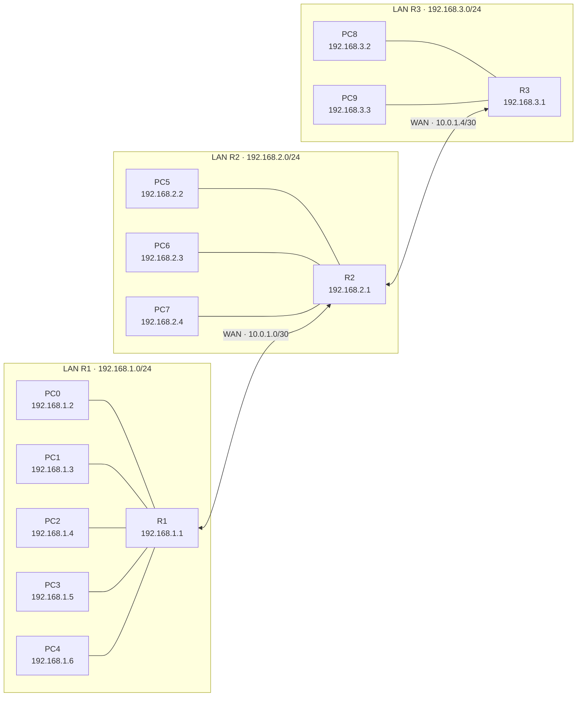

# 🌐 Praktikum IP Routing

Eksperimen ini menguji komunikasi antar-PC dalam satu LAN dan komunikasi antar-LAN melalui router. Pengujian konektivitas dilakukan menggunakan `ping`.

## 🗺️ Topologi Jaringan



## 🧩 Pembagian Perangkat

| Router | PC yang terhubung | Subnet LAN |
|---|---|---|
| R1 | PC0, PC1, PC2, PC3, PC4 | `192.168.1.0/24` |
| R2 | PC5, PC6, PC7 | `192.168.2.0/24` |
| R3 | PC8, PC9 | `192.168.3.0/24` |

## 🧮 Tabel Pengalamatan IP

| Perangkat | Terhubung ke | Alamat IP | Subnet mask | Default gateway |
|---|---|---|---|---|
| R1 — interface LAN | LAN R1 | `192.168.1.1` | `255.255.255.0` | — |
| PC0 | R1 | `192.168.1.2` | `255.255.255.0` | `192.168.1.1` |
| PC1 | R1 | `192.168.1.3` | `255.255.255.0` | `192.168.1.1` |
| PC2 | R1 | `192.168.1.4` | `255.255.255.0` | `192.168.1.1` |
| PC3 | R1 | `192.168.1.5` | `255.255.255.0` | `192.168.1.1` |
| PC4 | R1 | `192.168.1.6` | `255.255.255.0` | `192.168.1.1` |
| R2 — interface LAN | LAN R2 | `192.168.2.1` | `255.255.255.0` | — |
| PC5 | R2 | `192.168.2.2` | `255.255.255.0` | `192.168.2.1` |
| PC6 | R2 | `192.168.2.3` | `255.255.255.0` | `192.168.2.1` |
| PC7 | R2 | `192.168.2.4` | `255.255.255.0` | `192.168.2.1` |
| R3 — interface LAN | LAN R3 | `192.168.3.1` | `255.255.255.0` | — |
| PC8 | R3 | `192.168.3.2` | `255.255.255.0` | `192.168.3.1` |
| PC9 | R3 | `192.168.3.3` | `255.255.255.0` | `192.168.3.1` |

## 🔗 Pengalamatan WAN

| Koneksi | Subnet | IP interface router |
|---|---|---|
| R1 ↔ R2 | `10.0.1.0/30` | R1: `10.0.1.1`, R2: `10.0.1.2` |
| R2 ↔ R3 | `10.0.1.4/30` | R2: `10.0.1.5`, R3: `10.0.1.6` |

Subnet `/30` menyediakan dua alamat host yang dapat digunakan, sehingga cocok untuk koneksi point-to-point antar-router.

## 🧪 Hasil Eksperimen

Pengujian dilakukan dengan mengirim paket ICMP menggunakan perintah `ping`.

| Pengujian | Hasil |
|---|---|
| Komunikasi antar-PC pada LAN R1 | ✅ Berhasil |
| Komunikasi antar-PC pada LAN R2 | ✅ Berhasil |
| Komunikasi antar-PC pada LAN R3 | ✅ Berhasil |
| Komunikasi antar-LAN sebelum koneksi WAN dan routing | ❌ Belum berhasil |
| Komunikasi antar-LAN setelah koneksi WAN dan routing | ✅ Berhasil setelah rute dikonfigurasi |

### Kesimpulan

PC dalam LAN yang sama dapat berkomunikasi melalui router masing-masing. Komunikasi antara LAN R1, R2, dan R3 memerlukan koneksi WAN antar-router serta konfigurasi routing menuju subnet tujuan.

## 💻 Contoh Pengujian

Jalankan perintah berikut dari PC sumber:

```bash
ping 192.168.2.2
```

Alamat `192.168.2.2` pada contoh adalah PC5. Sesuaikan alamat tujuan dengan perangkat yang ingin diuji.
